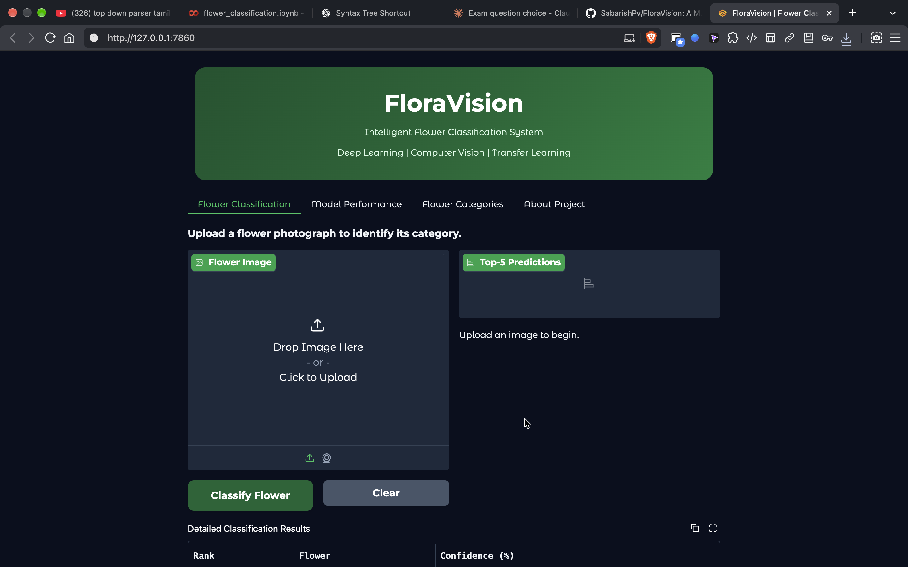
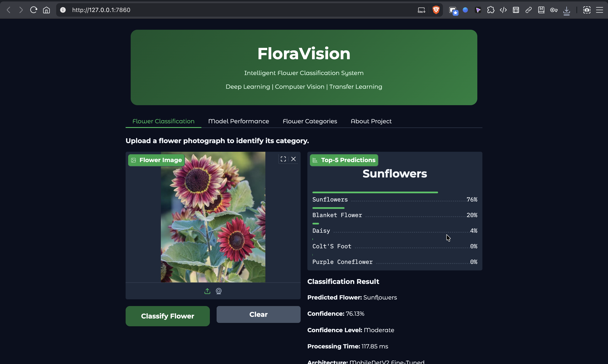
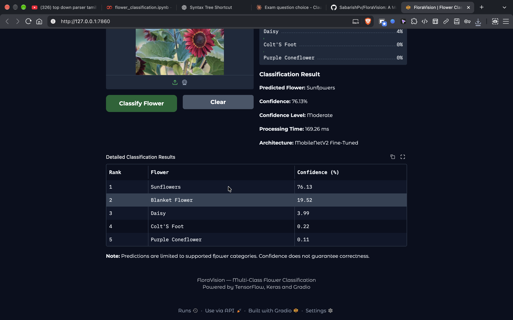
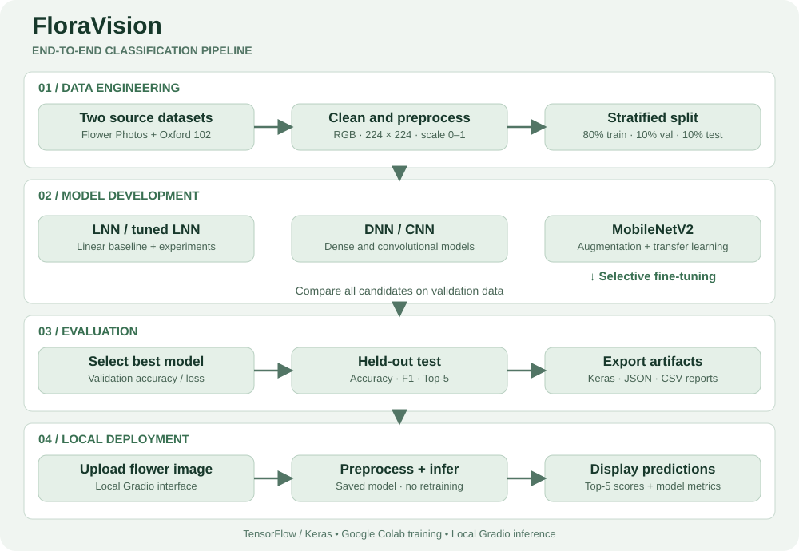

# FloraVision

**Multi-class flower classification using deep learning and an interactive Gradio application.**

   

## Application preview

### Flower classification



### Prediction example



### Model performance



## Overview

FloraVision explores how progressively more expressive neural network architectures improve flower image classification. The project combines two image datasets, implements a reproducible preprocessing pipeline, compares linear, dense and convolutional models, and investigates transfer learning and selective fine-tuning using MobileNetV2. The best validation checkpoint is exported to a local Gradio application for image and webcam inference without retraining.

## Features

- Dataset integration, corrupted-image detection and exact duplicate detection.
- RGB conversion, 224 × 224 resizing, normalization and batched TensorFlow datasets.
- Stratified training, validation and test splits.
- Baseline LNN, hyperparameter experiments, DNN, CNN and pretrained MobileNetV2.
- Data augmentation, transfer learning, selective fine-tuning and checkpointing.
- Accuracy, precision, recall, F1-score, Top-5 accuracy and confusion matrix analysis.
- Local Gradio interface with Top-5 predictions, inference time, model comparison and supported categories.

## Datasets

| Dataset | Original images (approx.) | Original categories |
|---|---:|---:|
| [TensorFlow Flower Photos](https://storage.googleapis.com/download.tensorflow.org/example_images/flower_photos.tgz) | 3,670 | 5 |
| [Oxford 102 Flowers](https://www.robots.ox.ac.uk/~vgg/data/flowers/102/) | 8,189 | 102 |

The original five categories are daisy, dandelion, roses, sunflowers and tulips. Oxford images are organized using their numeric labels and corresponding category names. Selected overlapping categories are merged: rose → roses, sunflower → sunflowers, common dandelion → dandelion, oxeye daisy and barbeton daisy → daisy. Other Oxford categories retain their own labels. The expected combined taxonomy contains 102 categories; actual counts are recorded in the exported metadata after cleaning. The Oxford official split is not used; the merged dataset is stratified independently.

## End-to-end workflow



## Implementation stages

| Step | Work completed |
|---:|---|
| 1 | Configure Google Colab and GPU runtime |
| 2 | Extract Flower Photos dataset |
| 3 | Organize project directories |
| 4 | Download Oxford images and labels |
| 5 | Extract images and map category IDs |
| 6 | Inspect and visualize Oxford samples |
| 7 | Merge datasets and reconcile selected labels |
| 8 | Detect corrupted files, exact duplicates and conflicting labels; inspect class distribution |
| 9 | Decode JPEG images into RGB tensors |
| 10 | Resize to 224 × 224 × 3 |
| 11 | Normalize pixel values from 0–255 to 0–1 |
| 12 | Stratified split, batching and prefetching |
| 13 | Implement baseline linear neural network |
| 14 | Train, visualize learning curves and save baseline |
| 15 | Run hyperparameter experiments |
| 16 | Compare experiments and save best LNN |
| 17 | Implement deep neural network |
| 18 | Train and evaluate DNN |
| 19 | Implement convolutional neural network |
| 20 | Train and evaluate CNN |
| 21 | Implement training-time augmentation |
| 22 | Build pretrained MobileNetV2 classifier |
| 23 | Train classification head with frozen backbone |
| 24 | Selectively fine-tune deeper pretrained layers |
| 25 | Select final model and evaluate held-out test data |
| 26 | Predict external images, export and verify model |
| 27 | Deploy interactive Gradio application locally |

## Preprocessing

Images are decoded to three RGB channels, resized with TensorFlow and divided by 255. The nominal split is 80% training, 10% validation and 10% testing. Training data is shuffled; validation and test data preserve order. The default batch size is 32, with parallel preprocessing and prefetching. Exact same-class duplicates and corrupted files are removed; detected cross-label conflicts are excluded from splitting. Augmentation is applied inside the transfer-learning model only during training: horizontal flip, rotation, zoom, translation and contrast. MobileNetV2 additionally rescales normalized inputs to [-1, 1] inside the saved model.

## Model architectures

| Model | Architecture | Initial learning rate | Maximum epochs |
|---|---|---:|---:|
| Baseline LNN | Flatten → Dense(C) → Softmax | 0.001 | 15 |
| Optimized LNN | Same linear architecture, tuned optimizer and batch size | Experiment dependent | 15 |
| DNN | Flatten → Dense(256) → Dense(128) → Softmax, with ReLU, batch normalization and dropout | 0.0001 | 20 |
| CNN | Four convolution blocks (32, 64, 128, 256 filters), pooling, global average pooling, Dense(128), dropout, Softmax | 0.001 | 30 |
| MobileNetV2 | Frozen ImageNet backbone → global average pooling → Dense(256, ReLU) → dropout → Softmax | 0.001 | 15 |
| Fine-tuned MobileNetV2 | Selectively unfreeze last 30 backbone layers, excluding batch normalization | 0.00001 | 10 |

C denotes the number of categories. All models use sparse categorical cross-entropy. Adam is the default optimizer; SGD is also explored in the LNN experiments. Early stopping, learning-rate reduction and checkpointing are used in applicable stages. Epoch counts are upper bounds, not necessarily actual training durations.

### Hyperparameter experiments

| Experiment | Batch size | Learning rate | Optimizer |
|---|---:|---:|---|
| Baseline | 32 | 0.001 | Adam |
| LNN 1 | 32 | 0.0001 | Adam |
| LNN 2 | 64 | 0.0001 | Adam |
| LNN 3 | 32 | 0.0005 | Adam |
| LNN 4 | 32 | 0.0001 | SGD |

The loss function and hidden-layer configurations are chosen for the respective architectures, rather than exhaustively tuned independently.

## Evaluation and results

Model selection uses validation accuracy, with validation loss as a tie-breaker in the final comparison. The selected model is then evaluated on the held-out test split. Macro metrics give each class equal importance; weighted F1 accounts for class support. Top-5 accuracy measures whether the true category is among the five highest-scoring predictions.

Actual numerical results are available in the exported files (no estimated accuracy is substituted for measured results):

| Artifact | Contents |
|---|---|
| [Final evaluation](results/final_evaluation_summary.csv) | Selected model, test accuracy, precision, recall, F1 and Top-5 accuracy |
| [Architecture comparison](results/final_architecture_comparison.csv) | Validation accuracy, loss and parameter counts |
| [Training benchmarks](results/all_model_results.csv) | Training configurations, performance and runtime |
| [Hyperparameter results](results/hyperparameter_results.csv) | LNN experiments |
| [Classification report](results/classification_report.csv) | Per-class metrics and support |
| [Confusion matrix](results/confusion_matrix.png) | Actual versus predicted categories |

## Repository structure

```text
FloraVision/
├── README.md
├── app.py
├── requirements.txt
├── .gitignore
├── notebooks/
│   └── flower_classification.ipynb
├── models/
│   ├── final_flower_classifier.keras
│   ├── class_names.json
│   └── model_metadata.json
├── results/
│   ├── final_evaluation_summary.csv
│   ├── final_architecture_comparison.csv
│   ├── all_model_results.csv
│   ├── hyperparameter_results.csv
│   ├── classification_report.csv
│   └── confusion_matrix.png
├── TEST_IMAGES/
└── assets/
    ├── architecture.svg
    ├── gradio_interface.png
    ├── prediction_example.png
    └── model_performance.png
```

## Run locally

Python 3.11 is recommended, subject to TensorFlow compatibility on your platform. Clone this repository using the URL shown under GitHub's **Code** menu, then enter the repository directory. If model weights are stored with Git LFS, install Git LFS and run `git lfs pull`. If weights are distributed separately, place the downloaded `.keras` file in `models/`.

```bash
python3 -m venv venv
source venv/bin/activate
python -m pip install --upgrade pip
pip install -r requirements.txt
python app.py
```

On Windows, activate with `venv\Scripts\activate` instead. Open **http://127.0.0.1:7860**. Upload a flower photograph or use the webcam, then select **Classify Flower**. No training dataset or GPU is needed for inference. Match the TensorFlow version recorded in `models/model_metadata.json` if deserialization fails.

### Gradio interface

The application contains four tabs: Flower Classification, Model Performance, Flower Categories and About Project. It loads the exported Keras model, class mapping and evaluation metadata, and reports the five highest-scoring categories and processing time.


## Reproduce training

Open `notebooks/flower_classification.ipynb` in Google Colab, enable a GPU runtime, and execute the notebook in order. Download the datasets from their original sources and follow the notebook's directory setup. Preserve the exported class mapping alongside the final model. The experiment uses seed 42; exact reproducibility can vary by hardware and library versions.

## Technology stack

Python, TensorFlow, Keras, NumPy, Pandas, Matplotlib, Scikit-learn, SciPy, Pillow, Google Colab and Gradio.

## Limitations and future scope

The classifier is closed-set: it cannot reliably reject unknown flowers or non-flower images. Softmax scores are not calibrated confidence estimates. Class imbalance, broad versus species-level label definitions, and undetected near-duplicates may affect generalization. The merged split is not directly comparable to the official Oxford benchmark. Future work includes perceptual deduplication, independent external evaluation, confidence calibration, unknown-class detection and mobile or web deployment.

## Acknowledgments

- TensorFlow Flower Photos dataset contributors.
- Oxford Visual Geometry Group, Flowers 102 dataset (Nilsback and Zisserman).
- TensorFlow/Keras, MobileNetV2 and Gradio open-source projects.

Dataset and pretrained-weight usage remain subject to their respective terms. Raw datasets are not redistributed in this repository.
